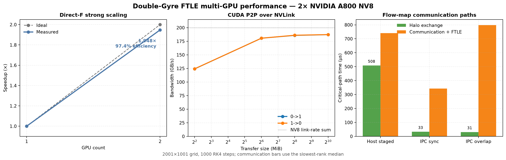

# FTLE-HPC：Double-Gyre 的 CUDA 与 Multi-GPU 优化

本项目以二维 Double-Gyre 的有限时间李雅普诺夫指数（FTLE）为基准，围绕粒子轨迹积分、变形梯度演化和 flow-map 有限差分进行 CUDA 与 Multi-GPU 优化。项目保留 CPU/CUDA 基准、误差门槛、Profiler 证据、1→2 GPU 强扩展、CUDA IPC/NVLink Halo 交换和可复现的优化过程。

## 计算流程

每个初始粒子独立执行：

1. RK4 积分粒子位置；
2. 同步积分变形梯度 $\dot{F}=\nabla u\,F$；
3. 计算右 Cauchy–Green 张量 $C=F^\mathsf{T}F$；
4. 使用最大特征值计算

$$
\mathrm{FTLE}=\frac{1}{2|\tau|}\log\lambda_{\max}(C).
$$

Double-Gyre 的外边界保持不变，代码仅用裁剪消除浮点舍入产生的微小越界。

## 最终实现

正式入口为：

```text
double_gyre_ftle_cuda_optimized.py
```

它不依赖 V1–V10，包含两种模式：

- `strict`：状态、RK4 和三角函数均使用 FP64，是默认科学参考；
- `mixed`：状态、变形梯度、时间系数、RK4 和 FTLE 保持 FP64，仅将成对的 `sincospi` 降为 FP32。

当前 A100 最终配置：

```text
threads              = 64
chunk_steps          = 50
time coefficients    = precomputed
registers/thread     = 72 (mixed), 78 (strict)
local memory/thread  = 0 B
```

严格模式：

```bash
python double_gyre_ftle_cuda_optimized.py \
  --mode strict \
  --nx 2001 --ny 1001 \
  --dt 0.01 --tau 10 \
  --threads 64 --chunk-steps 50 \
  --output results/final_strict.npz \
  --metrics results/final_strict.json
```

验证后的高性能模式：

```bash
python double_gyre_ftle_cuda_optimized.py \
  --mode mixed \
  --nx 2001 --ny 1001 \
  --dt 0.01 --tau 10 \
  --threads 64 --chunk-steps 50 \
  --warmup-runs 2 --repeats 7 \
  --verify \
  --output results/final_mixed.npz \
  --metrics results/final_mixed.json
```

结果文件包含 `x_grid`、`y_grid`、`ftle`、`x_final` 和 `y_final`。压缩保存时间单独统计，不计入 GPU kernel 或端到端计算时间。

## A100 结果

测试环境：Ubuntu 22、NVIDIA A100-SXM4-40GB、Driver 550.127.05、CUDA 12.4、Python 3.11、Numba 0.67.0、numba-cuda 0.30.4。

### 受控优化演进

统一工况：$2001\times1001$ 粒子，2,003,001 个初始点，$\Delta t=0.01$，$\tau=10$，1000 个 RK4 步。下表来自各阶段的受控实验，用于说明每项优化的贡献；正式版本比较见下一节。

| 版本 | 核心变化 | 积分时间 | 相对 V1 |
|---|---|---:|---:|
| V1 | 每个时间步一次 CUDA launch | 0.2946 s | 1.00× |
| V2 | `chunk_steps=50`，1000 次降为 20 次 launch | 0.2341 s | 1.26× |
| V4 | 预计算 RK4 时间系数 | 0.2075 s | 1.42× |
| V7 | FP64 `libdevice.sincospi` | 0.1589 s | 1.85× |
| Final mixed | FP32 `sincospif` + FP64 状态/RK4 | 0.0954 s | **3.09×** |

### 正式单 GPU 基准

以下结果由 `benchmarks/bench_single_gpu.py` 在同一次运行中生成，使用相同网格、参数、预热和重复计时口径。`compute(s)` 对 V1 表示 RK4 kernel 时间，对 optimized 表示积分与 FTLE kernel 总时间，因此这是对 optimized 略保守的比较。

| 网格 | 粒子数 | V1 compute | Strict compute | Mixed compute | Strict/V1 | Mixed/V1 | Mixed 吞吐量 |
|---|---:|---:|---:|---:|---:|---:|---:|
| 241×121 | 29,161 | 0.053371 s | 0.004754 s | 0.003175 s | 11.226× | **16.809×** | 9.184 billion psteps/s |
| 501×251 | 125,751 | 0.054186 s | 0.014345 s | 0.008818 s | 3.777× | **6.145×** | 14.261 billion psteps/s |
| 1001×501 | 501,501 | 0.075139 s | 0.040414 s | 0.030626 s | 1.859× | **2.453×** | 16.375 billion psteps/s |
| 2001×1001 | 2,003,001 | 0.297615 s | 0.159245 s | 0.096102 s | 1.869× | **3.097×** | **20.842 billion psteps/s** |

在最大网格上，最终 mixed 相对 V1 加速 **3.097×**，compute time 下降 **67.71%**；相对 strict 还快 **1.657×**。小网格上的 16.809× 主要包含减少 kernel launch 开销的收益，不能当作大规模稳态吞吐量的代表。


### 数值误差

在 $\tau=10$ 下，mixed 相对 strict FP64：

```text
relative L2 FTLE error = 1.710e-7
max absolute FTLE error = 1.151e-5
mean absolute FTLE error = 5.106e-9
max |det(F)-1| = 3.687e-10
boundary error = 0
```

项目采用的默认门槛为：

```text
relative L2 <= 1e-5
max absolute <= 1e-4
max |det(F)-1| <= 1e-7
```

混合精度在 $\tau=1,5,10$ 下通过，但在 $\tau=20$ 时最大绝对误差达到 `9.438e-4`，超过当前门槛。不要把“$\tau\le10$”推广为其他流场的通用规则；新参数或新数据必须重新使用 `--verify`。长时间窗口优先使用 `strict`。

## 2×A800 Multi-GPU 结果

多 GPU 实验运行在 2×NVIDIA A800-SXM4-40GB 上。两张 GPU 之间显示 `NV8`，P2P read/write 均可用。Double-Gyre 使用解析速度场，因此项目实现了两种互补路径：

- **direct-F**：每个粒子直接积分 $F$，粒子之间独立，用于测量域分解强扩展；
- **flow-map**：积分最终位置后用空间有限差分计算 FTLE，需要相邻子域的一行 Halo，用于测量真实通信路径。

### Direct-F 强扩展

统一工况：$2001\times1001$、2,003,001 个粒子、1000 个 RK4 步、mixed 模式、7 次重复。

| GPU 数 | Distributed wall | 吞吐量 | Speedup | Parallel efficiency |
|---:|---:|---:|---:|---:|
| 1 | 0.109111 s | 18.358 billion psteps/s | 1.000× | 100.0% |
| 2 | 0.056026 s | 35.751 billion psteps/s | **1.948×** | **97.4%** |

2 GPU 仍然通过 strict-FP64 数值验证：relative-L2 FTLE error 为 `1.710e-7`，最大绝对误差为 `1.151e-5`。

### NVLink P2P 带宽

使用双向 `cudaMemcpyPeerAsync` 和数据回读校验测量：

| Transfer size | 0→1 | 1→0 |
|---:|---:|---:|
| 4 MiB | 124.23 GB/s | 124.33 GB/s |
| 64 MiB | 180.64 GB/s | 180.61 GB/s |
| 256 MiB | 185.86 GB/s | 186.09 GB/s |
| 1024 MiB | 187.17 GB/s | **187.27 GB/s** |

大消息达到 NV8 八条 25 GB/s link-rate 总和的约 93.6%。该比例只用于描述当前节点的有效 P2P 带宽，不等同于应用 kernel 的整体利用率。

### Halo 通信路径

Flow-map 版本按连续 y 行分区，每个 rank 接收一行、32,016 bytes 的 `(x_final, y_final)` Halo。下表使用两个 rank 中较慢一方的中位数：

| 模式 | Halo exchange | 通信+FTLE 阶段 | Halo 相对 Host | 分布式验证 |
|---|---:|---:|---:|---:|
| Host staged | 508.0 μs | 741.2 μs | 1.00× | 通过 |
| CUDA IPC sync | **33.0 μs** | **343.2 μs** | **15.40×** | 通过 |
| CUDA IPC overlap | 30.8 μs | 798.2 μs | 16.47× | 通过 |

推荐 `ipc_sync`：它将 Halo 延迟降低 15.40×，并使通信+FTLE 阶段相对 Host staging 加速 2.16×。`ipc_overlap` 虽然保持了低 P2P 延迟，但需要把 FTLE 拆成 interior 和 boundary kernel；对于只有约 30 μs 的通信，额外 launch 与同步成本超过了可隐藏时间。

三种通信路径相对单体 global flow-map 的最大绝对误差为 `1.110e-16`，relative-L2 为 `3.336e-17`。Flow-map 与 direct-F 在 $\tau=10$ 下的 relative-L2 差异约为 `8.09e-2`，它来自长积分窗口下的有限差分离散误差，不是域分解或 Halo 通信错误。科学主结果仍优先使用 direct-F；flow-map 路径用于展示和研究邻域依赖与通信。



## 优化与分析结论

- Multi-step fusion 将主 RK4 launch 数从 1000 降为 20；
- 时间系数表只有 48 KB，消除了每个粒子重复计算 $\sin(\omega t)$；
- 强制 `max_registers` 会产生 local-memory spill，所有测试配置均变慢；
- `fastmath` 在 FP64 下没有收益；
- V7 的成对 FP64 `sincospi` 将寄存器从 96 降至 78；
- mixed trig 进一步将寄存器降至 72，同时保留 FP64 轨迹与 RK4 累加。

Nsight Compute 对 `threads=64` 的主 kernel 给出：

| 指标 | Strict FP64 trig | Mixed FP32 trig |
|---|---:|---:|
| Kernel duration | 10.03 ms | 5.92 ms |
| Executed instructions | 2.010B | 1.647B |
| Registers/thread | 78 | 72 |
| Theoretical occupancy | 37.50% | 43.75% |
| Achieved occupancy | 36.10% | 40.93% |
| Active warps/SM | 23.10 | 26.19 |
| No eligible cycles | 57.32% | 40.70% |
| Warp cycles/instruction | 13.56 | 11.06 |

主 kernel 仍然是计算受限而非内存受限。NCU 会重放 kernel 并改变执行环境，因此正式性能数字来自正常 CUDA Event benchmark；NCU 数据用于解释瓶颈。

## 自动测试

```bash
python tests/test_optimized.py -v
```

小网格测试覆盖：

- strict CUDA 对 CPU reference；
- mixed CUDA 对 strict CUDA；
- FTLE 形状和有限值；
- 粒子边界和 $\det(F)$；
- kernel launch 数和系数表大小。

没有 CUDA 的环境会跳过测试，而不是报告伪失败。

## 统一单 GPU Benchmark

```bash
python benchmarks/bench_single_gpu.py \
  --grids 241x121,501x251,1001x501,2001x1001 \
  --tau 10 --dt 0.01 \
  --warmup-runs 2 --repeats 7 \
  --output results/single_gpu_benchmark.json \
  --csv results/single_gpu_benchmark.csv
```

该脚本自动运行：

- V1 CUDA baseline；
- optimized strict；
- optimized mixed，并对 strict 验证。

每次子进程的完整日志和 metrics 会保存在 `results/single_gpu_runs/`。

重新生成性能图：

```bash
python benchmarks/plot_single_gpu_benchmark.py \
  --input results/single_gpu_benchmark.csv \
  --output assets/single_gpu_benchmark.png
```

## 文件结构

```text
ftle_hpc/
├── double_gyre_ftle_baseline.py
├── double_gyre_ftle_cuda_optimized.py
├── double_gyre_ftle_multi_gpu.py
├── double_gyre_ftle_multi_gpu_ipc.py
├── bench_p2p_nvlink.py
├── double_gyre_ftle_cuda_v1.py ... double_gyre_ftle_cuda_v10.py
├── benchmarks/
│   ├── bench_single_gpu.py
│   ├── plot_single_gpu_benchmark.py
│   └── summarize_final_results.py
├── assets/
│   ├── single_gpu_benchmark.png
│   └── a800_multi_gpu_summary.png
├── docs/
│   └── resume_project_description_zh.md
├── tests/
│   ├── test_optimized.py
│   └── test_multi_gpu.py
├── results/
└── README.md
```

V1–V10 是受控优化实验和证据链；正式单 GPU 运行使用 optimized 入口，direct-F 强扩展使用 `double_gyre_ftle_multi_gpu.py`，Halo/NVLink 实验使用 `double_gyre_ftle_multi_gpu_ipc.py`。

## CUDA 驱动排查

如果 `numba.cuda.is_available()` 报告找不到 `cuInit`，检查 `LD_LIBRARY_PATH` 中是否误加入 CUDA stub：

```bash
echo "$LD_LIBRARY_PATH" | tr ':' '\n'
```

不要把以下目录放入运行时库搜索路径：

```text
/usr/local/cuda-12.4/targets/x86_64-linux/lib/stubs
```

stub 只用于链接，不包含真实 NVIDIA driver API。服务器上的 `libcuda.so.1` 应由 NVIDIA 驱动提供。

## Multi-GPU 复现命令

Direct-F 1→2 GPU 强扩展：

```bash
python double_gyre_ftle_multi_gpu.py \
  --devices 0,1 \
  --mode mixed --verify \
  --nx 2001 --ny 1001 \
  --dt 0.01 --tau 10 \
  --threads 64 --chunk-steps 50 \
  --warmup-runs 2 --repeats 7 \
  --no-save \
  --metrics results/a800_strong_2gpu_2001x1001.json
```

CUDA IPC 同步 Halo：

```bash
python double_gyre_ftle_multi_gpu_ipc.py \
  --devices 0,1 \
  --mode mixed \
  --communication ipc_sync \
  --nx 2001 --ny 1001 \
  --dt 0.01 --tau 10 \
  --threads 64 --chunk-steps 50 \
  --warmup-runs 2 --repeats 7 \
  --no-save \
  --metrics results/a800_ipc_sync_formal.json
```

NVLink P2P microbenchmark：

```bash
python -u bench_p2p_nvlink.py \
  --devices 0,1 \
  --sizes-mib 4,64,256,1024 \
  --target-gib 16 \
  --output results/a800_p2p_nvlink.json
```

重新生成最终汇总和图片：

```bash
python benchmarks/summarize_final_results.py
```

`--devices` 使用 `CUDA_VISIBLE_DEVICES` 之后的逻辑编号。每张 GPU 使用一个独立 Python 进程与 CUDA context，正式 wall time 通过进程屏障对齐，并以最慢 rank 的完成时刻为准；不能把各 GPU kernel 时间相加作为分布式总时间。

当前项目只报告实际测得的 1 GPU 与 2 GPU 结果，不把 2 GPU 数据外推成未经验证的 4 GPU 结论。
